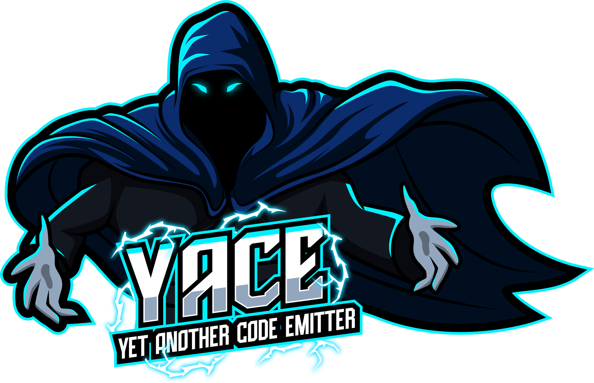

Welcome to yace
===============

.. image:: https://img.shields.io/pypi/v/yace.svg
   :target: https://pypi.org/project/yace
   :alt: PyPI

.. image:: https://github.com/safl/yace/actions/workflows/docs.yml/badge.svg
   :target: https://github.com/safl/yace/actions
   :alt: Build Status

.. image:: https://coveralls.io/repos/github/safl/yace/badge.svg?branch=main
   :target: https://coveralls.io/github/safl/yace?branch=main

.. image:: https://img.shields.io/badge/pre--commit-enabled-brightgreen?logo=pre-commit
   :target: https://github.com/safl/yace/blob/main/.pre-commit-config.yaml
   :alt: pre-commit

**yace** generates the bindings of a C API for other languages. You describe the
FFI boundary of the API as a C header, in a subset of C99 that can be described
equivalently in C, C++, Python, Rust and Zig, and **yace** generates, for each,
code that is idiomatic for that language: for C, a C API with pretty-printers
for every struct, union and enum.

* The project is hosted on `GitHUB`_

* Documentation is available at `safl.dk/yace`_

Bindings are generated for C, C++, Python (ctypes, with a ``.pxd`` for
Cython), Rust, Zig and Go. Each target builds and runs a check of what it
generated against the layout the C compiler gives every record, and the C API
and Zig check every function's signature against the header too.

A header can also be written by a generator, from something other than C, and
taken as one written by hand: ``yace --generate file.py:Class``, or a
generator installed by name. A generator proposed to xNVMe writes its NVMe
specification headers so, from the data model senfd makes of the
specification documents.

Contributions are welcome; the documentation says how the code is laid out.

.. _GitHUB: https://github.com/safl/yace
.. _safl.dk/yace: https://safl.dk/yace

.. toctree::
   :maxdepth: 2
   :hidden:

   features.rst
   install/index.rst
   usage/index.rst
   ir/index.rst
   targets/index.rst
   generators/index.rst
   bench/index.rst
   survey/index.rst
   codebase/index.rst
